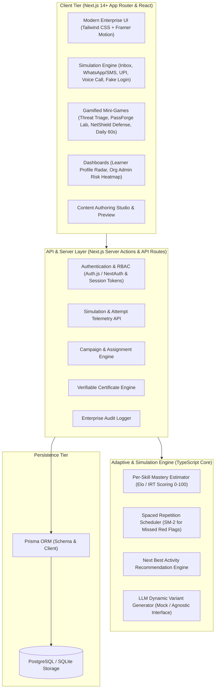
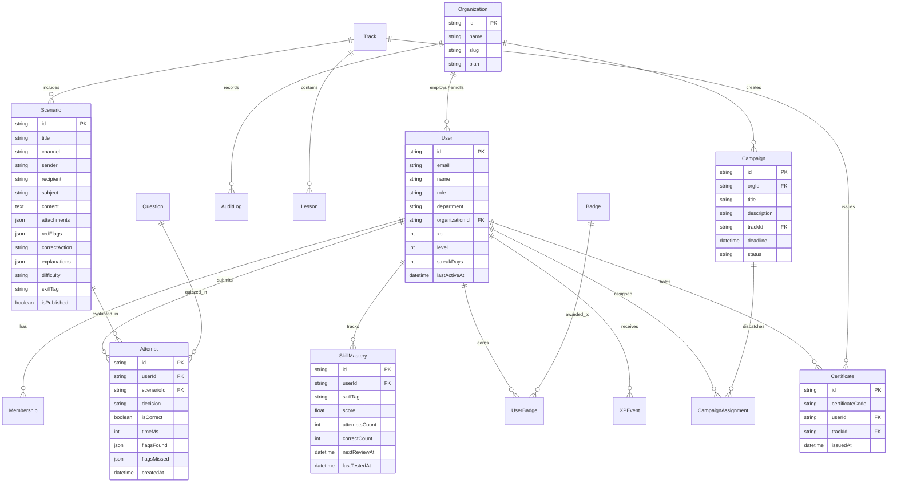

# AdaptSec Platform — Architecture & Implementation Plan

AdaptSec is a next-generation cybersecurity behavior-change and human risk management platform designed for individuals, SMBs, academic institutions, and enterprise teams.

---

## 1. High-Level System Architecture

---

## 2. Entity Relationship Diagram (ERD)

---

## 3. Core Modules & Specifications

### A. Adaptive Engine
- **Per-skill Mastery (0-100)**: Evaluated across 7 core cybersecurity competency domains:
  1. `phishing` (Phishing & Smishing)
  2. `credentials` (Passwords & MFA)
  3. `payments` (Payment/UPI & Invoice Fraud)
  4. `social_eng` (Social Engineering & Deepfake Voice)
  5. `browsing_wifi` (Safe Browsing & Public Wi-Fi)
  6. `data_privacy` (Data Handling & Privacy)
  7. `incident_response` (Incident Reporting & Threat Escalation)
- **Scoring Logic**: Elo-style expected outcome formula combining difficulty factor, user hesitation time, and missed red flags.
- **Spaced Repetition (SM-2)**: Calculates intervals (1 day, 3 days, 7 days, 16 days, 35 days) for specific missed attack indicators.
- **Next Best Activity**: Identifies lowest mastery skill with overdue reviews and serves tailored scenarios.

### B. Multi-Channel Simulation Engine
1. **Inbox Simulator**:
   - Header inspection (From, Return-Path, DKIM/SPF status)
   - Hover preview of hyperlinks displaying exact target domain
   - Attachment scanner with safe preview modal
   - Actions: *Report Phish*, *Ignore / Delete*, *Reply / Click*, *Forward to SOC*
2. **SMS & WhatsApp Simulator**:
   - Realistic mobile messaging bubble UI
   - Unknown sender badges, UPI payment links, urgent verification codes
3. **UPI & Payment Fraud Simulator**:
   - Real-world Indian mobile payment patterns (PhonePe, GPay, Paytm, BHIM style)
   - "Receive Money" traps that actually trigger "Pay / Enter PIN" requests
   - VPA verification indicators & merchant badges
4. **Voice Call / Vishing Simulator**:
   - Interactive timed audio transcript ticker (AI boss voice-clone, bank KYC officer, IT support)
   - Real-time response branch selection with hesitation countdown
5. **Fake Login Page Spotter**:
   - Browser chrome mockup with URL bar, SSL padlock status, homograph/punycode checks (e.g. `micros0ft.com`, `paypaI.com`)

### C. Gamified Mini-Games
1. **Threat Triage (Phish Shooter Upgraded)**: Fast-paced inbox stream; rapid Report vs Legitimate triage; streak multiplier; post-round debrief table with exact red flags.
2. **PassForge Lab**: 100% client-side password entropy evaluation using zxcvbn principles; crack time estimation; breach pattern analyzer; passphrase challenge mode.
3. **NetShield Defense**: Interactive HTML5 Canvas tower defense game; deploy safeguards (Email Gateway, Web Proxy, MFA, EDR/Antivirus, Immutable Backups) to intercept incoming attacks (Phishing, MITM, Brute Force, Malware, Ransomware).
4. **Daily Spot the Scam**: 60-second rapid-fire scenario challenge with weekly community leaderboard.

### D. Dashboards & Analytics
- **Learner Dashboard**: Real-time Human Risk Score (0-100), Recharts Skill Radar, streak calendar, recent badges, and adaptive action card.
- **Org Admin Dashboard**: Department-level risk heatmap, compliance completion metrics, top missed red flags, high-risk user detection (privacy-respecting), CSV and printable executive report export.

### E. Enterprise Features
- **Role-Based Access Control (RBAC)**: `LEARNER`, `ORG_ADMIN`, `MANAGER`, `AUTHOR`, `SUPER_ADMIN`.
- **Campaign Management**: Schedule company-wide training drives with automated reminder loggers.
- **Verifiable Certificates**: Cryptographically unique IDs with public verification portal `/verify/[code]`.
- **Content Studio**: Live authoring workspace for scenarios and quiz questions with instant preview.
- **Cyber Threat Feed**: Curated "Scam of the Week" cards convertible to active simulations.

---

## 4. Implementation Milestones

- **Milestone 1**: Project Scaffold, Dependencies, Enterprise Design System, Layout Shell, Landing Page.
- **Milestone 2**: Complete Database Schema (Prisma), Migrations, Seed Data with 60+ realistic attack scenarios.
- **Milestone 3**: Simulation Engine with 5 simulators (Inbox, SMS/WhatsApp, UPI, Voice Call, Fake Login) & feedback telemetry.
- **Milestone 4**: Adaptive Engine (pure TypeScript, unit-tested) + Interactive Quiz Engine + Baseline Assessment.
- **Milestone 5**: Gamified Mini-Games (Threat Triage, PassForge Lab, NetShield Defense, Daily 60s).
- **Milestone 6**: Learner Dashboard (Risk Score, Radar Chart, XP, Badges, Cyber Ranks).
- **Milestone 7**: Org Admin Dashboard, Campaigns, Verifiable Certificates, Author CMS, Threat Feed.
- **Milestone 8**: Vitest Unit Tests, Playwright E2E Tests, Documentation, Git Commits & Repository Sync.
