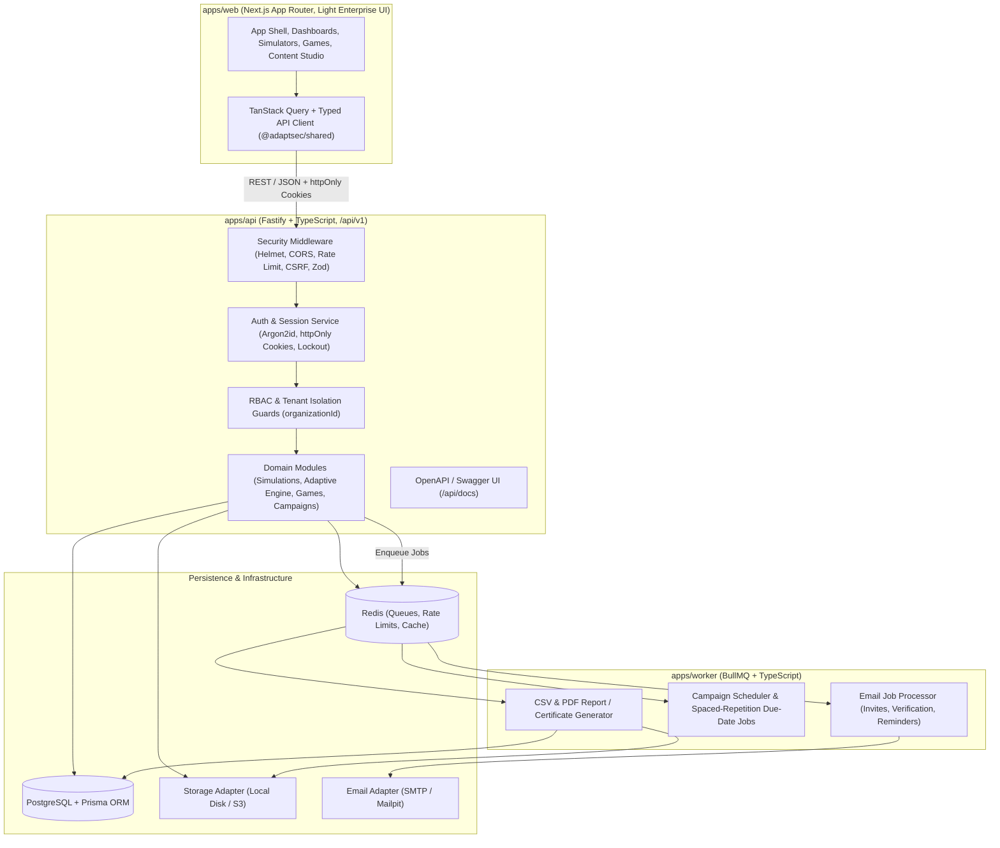
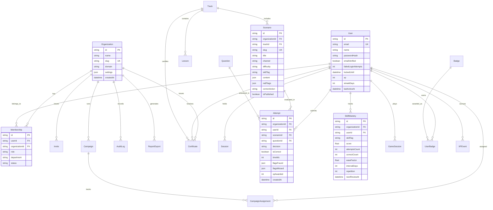

# AdaptSec — Enterprise Architecture & Implementation Plan

AdaptSec is a multi-tenant B2B SaaS security-awareness and human-risk management platform. The frontend is a thin client; all business logic, scoring, RBAC, multi-tenancy isolation, and persistence live in a standalone REST API and background worker backed by PostgreSQL and Redis.

---

## 1. System Architecture

---

## 2. Monorepo Structure (`pnpm` Workspaces)

- `apps/web`: Next.js 14+ (App Router, strict TypeScript, Tailwind CSS, Radix UI primitives, TanStack Query, React Hook Form + Zod, Recharts, Lucide icons).
- `apps/api`: Standalone Fastify REST API under `/api/v1` with OpenAPI docs at `/api/docs`, `/health`, `/ready`.
- `apps/worker`: BullMQ background worker consuming Redis queues for email delivery, campaign scheduling, spaced-repetition due-date notifications, and CSV/PDF report exports.
- `packages/shared`: Shared Zod schemas, TypeScript DTOs, constants, and design tokens imported by both `web`, `api`, and `worker`.
- `packages/db`: Prisma schema, PostgreSQL migrations, and realistic multi-org seed script.

---

## 3. Entity Relationship Diagram (ERD)

---

## 4. API Surface (`/api/v1`)

All endpoints enforce Zod input validation, centralized error envelopes (`{ error: { code, message, details?, requestId } }`), and tenant scoping (`organizationId`) where applicable.

| Domain | Endpoints |
| :--- | :--- |
| **System & Docs** | `GET /health`, `GET /ready`, `GET /api/docs` (Swagger UI) |
| **Auth** | `POST /auth/register`, `POST /auth/login`, `POST /auth/logout`, `POST /auth/refresh`, `POST /auth/verify-email`, `POST /auth/forgot-password`, `POST /auth/reset-password`, `GET /auth/me`, `GET /auth/sessions`, `DELETE /auth/sessions/:id` |
| **Orgs & Members** | `GET /orgs`, `POST /orgs`, `PATCH /orgs/:id`, `GET /memberships`, `PATCH /memberships/:id`, `DELETE /memberships/:id`, `GET /invites`, `POST /invites`, `POST /invites/accept`, `DELETE /invites/:id` |
| **Curriculum** | `GET/POST/PATCH/DELETE /tracks`, `GET/POST/PATCH/DELETE /lessons`, `GET/POST/PATCH/DELETE /scenarios` (paginated, filterable), `GET/POST/PATCH/DELETE /questions`, `POST /scenarios/import`, `GET /scenarios/export` |
| **Attempts & Adaptive** | `POST /attempts`, `GET /attempts`, `GET /skills/mastery`, `GET /recommendations/next` |
| **Games (Server-Validated)** | `POST /games/:type/start`, `POST /games/:type/event`, `POST /games/:type/finish` (`threat-triage`, `netshield`, `passforge`, `daily-spot`) |
| **Social & Recognition** | `GET /leaderboards`, `GET /badges`, `GET /certificates`, `POST /certificates/issue`, `GET /certificates/verify/:code` (public) |
| **Campaigns & Exports** | `GET/POST/PATCH /campaigns`, `GET /campaign-assignments`, `POST /campaigns/:id/remind`, `POST /reports/export`, `GET /reports/export`, `GET /reports/export/:id/download` |
| **Analytics & Feed** | `GET /analytics/org`, `GET /analytics/user`, `GET/POST/PATCH/DELETE /scam-of-the-week` |
| **Settings & Audit** | `GET/PATCH /settings/profile`, `GET/PATCH /settings/notifications`, `POST /settings/data-export`, `DELETE /settings/account`, `GET /audit-logs` |

---

## 5. Sensible Defaults for Ambiguities

1. **API Framework**: **Fastify 5 + TypeScript** with `@fastify/swagger`, `@fastify/cookie`, `@fastify/cors`, `@fastify/helmet`, `@fastify/rate-limit`, and `zod-to-json-schema` for OpenAPI generation.
2. **Auth & CSRF**: `argon2` password hashing; httpOnly `SameSite=Lax` signed JWT access cookie (15 min) + opaque DB-persisted refresh token cookie (7 days) with rotation; account lockout (exponential backoff after 5 failed attempts); Origin/Referer + custom header check for state-changing requests.
3. **Storage & Email Adapters**: Abstracted behind interfaces in `apps/api` and `apps/worker`. Local disk (`./storage`) in dev with S3-compatible adapter support via env vars; Nodemailer SMTP targeting Mailpit (`localhost:1025`) in dev.
4. **Design System**: Light theme only (`#FFFFFF` / `#F6F7F9` surfaces, `#E2E5EA` 1px borders, `#1E3A8A` deep indigo-blue primary brand color, Inter font, 6px–8px border radius). No dark mode, no gradients, no glow, no decorative animation.
5. **Local Test DB**: `prisma/schema.prisma` targets **PostgreSQL**. For environments without Docker/Postgres running natively, test helpers can run against PostgreSQL or an embedded `@electric-sql/pglite` instance, while `docker compose up` brings up full PostgreSQL 16 + Redis 7 + Mailpit.

---

## 6. Milestones

1. **Milestone 1**: Monorepo scaffold (`pnpm` workspaces), Docker Compose (Postgres, Redis, Mailpit, API, Worker, Web), Prisma DB schema + migrations, Fastify API skeleton (`/health`, `/ready`, `/api/docs`), Auth + RBAC + multi-tenancy guards, Light Enterprise Design Tokens & App Shell, `docs/UI_INVENTORY.md`.
2. **Milestone 2**: Comprehensive seed data (3 orgs, ~40 users, 3 months history, 60+ scenarios, 7 tracks, lessons, questions), Tracks/Lessons/Scenarios/Questions read APIs + UI.
3. **Milestone 3**: Attempts API + Simulation Engine + Inbox Simulator (and SMS/WhatsApp, UPI, Voice, Fake Login) end-to-end with DB persistence.
4. **Milestone 4**: Quiz Engine + server-side Adaptive Engine (Elo/IRT + SM-2) + Recommendations API & UI + Onboarding Baseline.
5. **Milestone 5**: Mini-games (Threat Triage, PassForge Lab, NetShield Defense, Daily Spot the Scam) with server-validated scoring sessions.
6. **Milestone 6**: Learner Dashboard, Gamification (XP, streaks, badges), Org Leaderboards, Verifiable Certificates + public verify page.
7. **Milestone 7**: Org Admin Dashboard (risk heatmap, trends, missed flags), Invites, Campaigns, BullMQ Worker jobs, Mailpit email delivery, CSV/PDF report exports, Audit logs.
8. **Milestone 8**: Content Authoring Studio (CRUD, live preview, JSON import/export), Scam of the Week, Settings (profile, data export, account deletion), Public Landing Page + Legal pages, Full API/E2E/Smoke test suite, Complete Docs & GitHub README with flowcharts.
