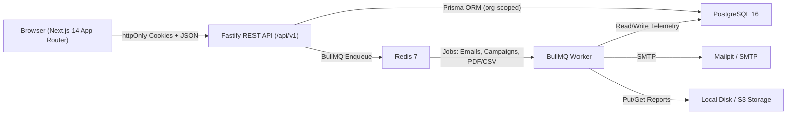
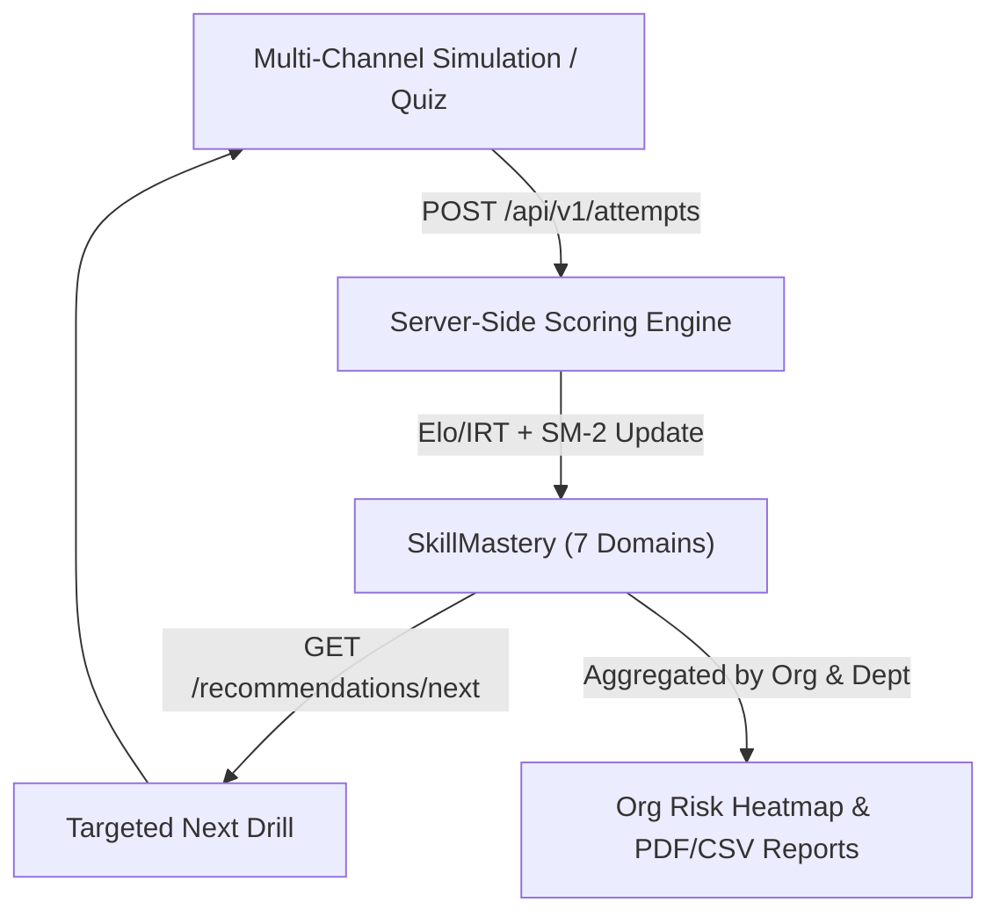

# AdaptSec — Enterprise Human Risk & Security Awareness Platform

AdaptSec is a multi-tenant B2B SaaS security-awareness platform that measures how employees and students respond to realistic phishing, SMS/WhatsApp smishing, UPI/payment scams, fake-boss BEC requests, voice-clone vishing, and credential-harvesting attacks—then adapts training to each person's weak spots.

---

## Architecture Overview



## Adaptive Learning Loop



---

## Monorepo Structure

- `apps/web` — Next.js 14 App Router + TypeScript + Tailwind CSS (light enterprise design system) + TanStack Query + Recharts
- `apps/api` — Fastify 5 REST API (`/api/v1`), Zod validation, Argon2id auth, Swagger/OpenAPI at `/api/docs`
- `apps/worker` — BullMQ background worker for SMTP notifications, campaign reminders, and `pdfkit`/CSV report generation
- `packages/shared` — Shared Zod schemas, DTOs, and design tokens
- `packages/db` — Prisma schema, SQL migrations, and realistic multi-org seed script

---

## Quick Start

### Option A: One-Command Docker Compose

```bash
cp .env.example .env
docker compose up --build
```

- Web Console: `http://localhost:3000`
- REST API & Swagger Docs: `http://localhost:4000/api/docs`
- Mailpit Email Catcher: `http://localhost:8025`

### Option B: Local Development (`pnpm`)

```bash
pnpm install
pnpm build
pnpm --filter @adaptsec/db exec prisma migrate deploy
pnpm --filter @adaptsec/db exec tsx prisma/seed.ts
pnpm dev
```

### Run Automated Test Suite

Tests run against an in-process PostgreSQL engine (`@electric-sql/pglite-socket`) with no external DB required:

```bash
pnpm --filter @adaptsec/api test
```

---

## Seeded Demo Accounts

All seeded accounts share the demo password: `AdaptSec@2026!`

| Role | Email | Workspace |
| :--- | :--- | :--- |
| Learner | `learner@meridian.in` | Meridian Systems |
| Org Admin | `admin@meridian.in` | Meridian Systems |
| Content Author | `author@meridian.in` | Meridian Systems |
| Super Admin | `superadmin@adaptsec.io` | Platform / Meridian |

---

## Documentation

- [Architecture](docs/architecture.md)
- [Adaptive Engine](docs/adaptive-engine.md)
- [Content Authoring](docs/content-authoring.md)
- [Deployment](docs/deployment.md)
- [UI Action Inventory](docs/UI_INVENTORY.md)
