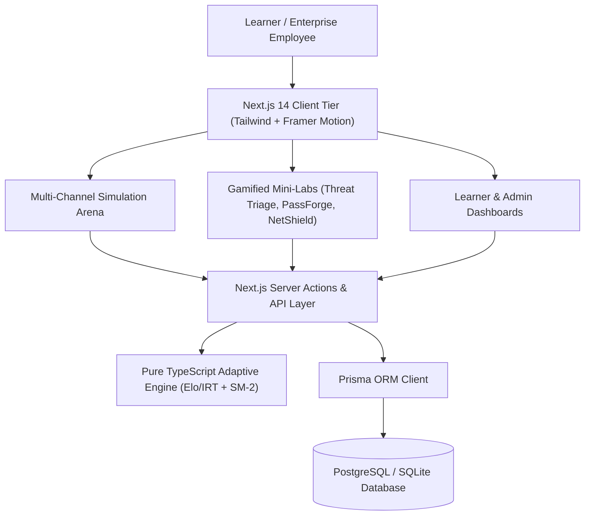

# AdaptSec — Platform Overview & Architecture Guide

## 1. Executive Summary
AdaptSec is an enterprise-grade cybersecurity behavior-change and human risk management platform. While perimeter defenses, endpoint detection, and firewalls protect the infrastructure, **the human layer remains the primary entry point for modern breaches**. Over 85% of breaches involve credential reuse, AI-crafted phishing, WhatsApp/SMS scams, payment fraud (UPI collect traps), executive impersonation (BEC), or deepfake audio.

Traditional annual compliance training fails because it is passive and non-adaptive. AdaptSec replaces text-heavy compliance slides with **real-world attack simulations**, measuring decision hesitation and cognitive blind spots, and dynamically adapting learning paths using machine-learning-inspired pedagogical models.

---

## 2. Target Users & Role-Based Access Control (RBAC)

AdaptSec enforces granular RBAC across five distinct persona tiers:

| Role | Target Persona | Capabilities & Permissions |
| :--- | :--- | :--- |
| **LEARNER** | Individual employee, student, or contractor | Accesses simulations, takes adaptive quizzes, plays defense mini-games, earns verifiable certificates and XP streaks. |
| **ORG_ADMIN** | CISO, IT Director, or Security Manager | Views organization risk heatmaps, monitors department compliance, dispatches training campaigns, exports audit logs and CSV reports. |
| **MANAGER** | Department Team Lead | Inspects privacy-masked team completion metrics and department-level risk scores. |
| **AUTHOR** | Cybersecurity Curriculum Engineer | Creates, edits, drafts, and publishes new attack scenarios and quiz questions with live simulator preview and JSON import/export. |
| **SUPER_ADMIN** | Platform Executive / Lead Admin | Full multi-tenant administration, system configuration, organization onboarding, and security policy oversight. |

---

## 3. High-Level System Architecture

---

## 4. Multi-Channel Simulation Vectors
AdaptSec implements 5 custom interactive simulators:
1. **Email Inbox Simulator**: Hoverable hyperlinks with target preview, inspectable SPF/DKIM headers, attachment security scanning.
2. **SMS & WhatsApp Mobile Simulator**: Real-world mobile messaging frame with Android APK malware traps, job review scams, and urgency lures.
3. **UPI & Digital Payments Simulator**: Mimicking mobile payment screens (PhonePe/GPay style), demonstrating the Golden Rule of UPI (*You NEVER enter a PIN to receive money*).
4. **Voice Call / Vishing Simulator**: Audio transcript tickers with timed hesitation measurement simulating AI executive voice cloning and fake law enforcement extortion.
5. **Fake Login Page Spotter**: Browser chrome frame with interactive SSL padlock verification and homoglyph domain detection.
